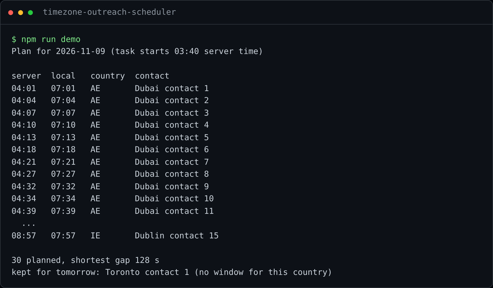

# Timezone Outreach Scheduler

**Reach people in their own morning, in every country, at a human pace, without setting an alarm
for 4 a.m.**

A message sent at 3 a.m. the recipient's time sinks under everything that arrives before they
wake up. When you prospect in several countries at once (Dublin and Dubai, for example), sending
at the right local time by hand means working in shifts. This scheduler plans each country's daily
queue inside its own morning window, spaces the actions like a person would, and never sends out
of hours.



## Results in production

Running every day since October 2026 for my own international outreach:

| | |
|---|---|
| **Volume** | **30 contacts a day** across two markets, 15 in Dublin and 15 in Dubai |
| **Timing** | Every action between **07:00 and 08:00 local time** in its country, all year, through daylight-saving changes |
| **Time** | About **15 hours a month** of manual sending, tracking and follow-up replaced by unattended daily jobs *(estimate: 30 minutes a day by hand)* |
| **Feedback** | Responses are detected daily, written to the sheet and sent to my phone |

## Features

- **Local windows per country:** each country has its own window in its own time zone; time
  zones and daylight saving come from the IANA database, so nothing needs changing twice a year.
- **Human pacing:** never two actions closer than 75 seconds, with the spare time spread at random
  (about one every 4 minutes).
- **Never out of hours:** if the machine was off or a run started late, whatever no longer fits in
  today's window waits for tomorrow.
- **Queue in Google Sheets:** prioritized and balanced across companies; status and dates are
  written back automatically.
- **Response tracking:** a daily job records who responded and notifies me on Telegram.
- **Respects rate limits:** when a channel signals a limit, the campaign pauses until the next
  day instead of insisting.

## Quick start

The public module (windows and pacing) runs with no dependencies.

**With Docker**

```bash
docker compose run --rm demo    # plan a day for 30 fictional contacts in Dublin and Dubai
docker compose run --rm test    # 7 tests, including both daylight-saving change days
```

**With Node.js 20+**

```bash
npm run demo
npm test
```

## Tech stack

Node.js, Playwright, Google Sheets API, Telegram Bot API, Windows Task Scheduler, Docker for the
demo.

## About this repo

A public, sanitized view of a private production system. `src/windows.mjs` is the production
scheduling logic, translated to English; the part that drives the browser, the contacts and the
credentials stay private. Built by [Miguel Morales García](https://miguelmoralesgarcia.es): I
designed the system and its rules, and wrote the code with AI assistants, choosing a different
one for each part of the job. More projects: [automation-portfolio](https://github.com/miguelmoga2002-alt/automation-portfolio).

## Want something like this?

I build outreach and follow-up automation for sales teams that sell across several markets.
Contact me through [miguelmoralesgarcia.es](https://miguelmoralesgarcia.es) or LinkedIn.

## License

MIT
